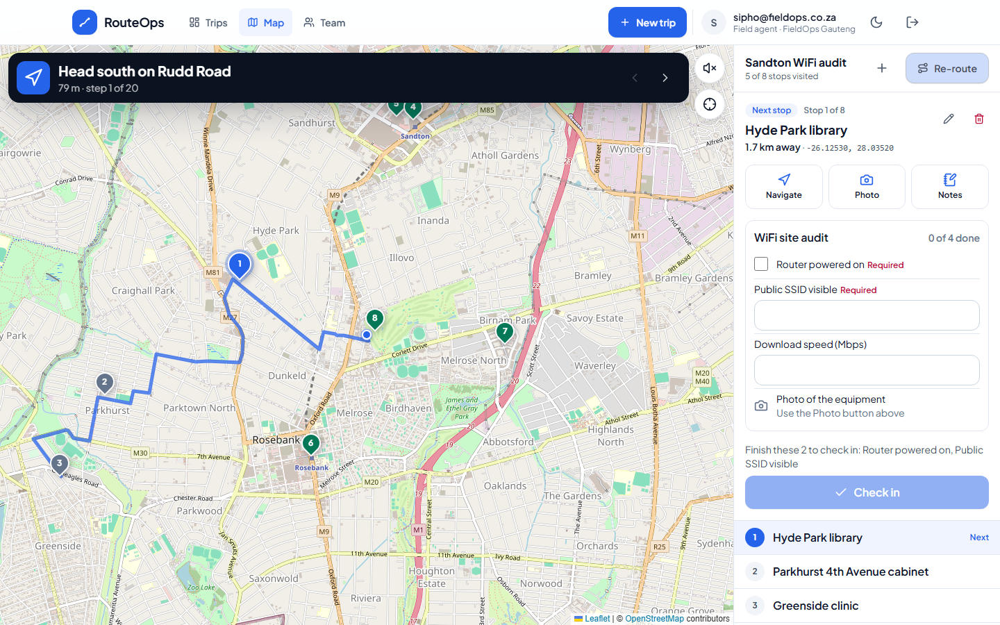
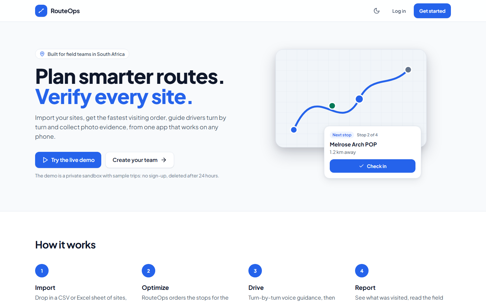
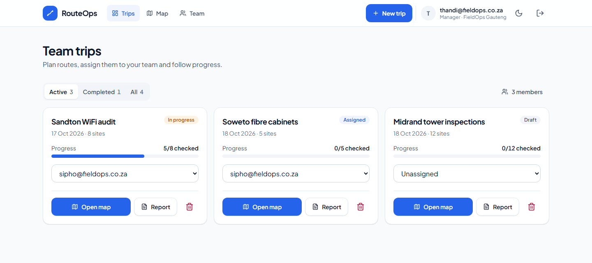
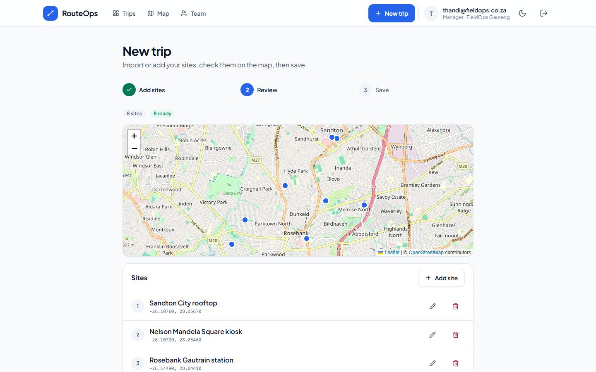
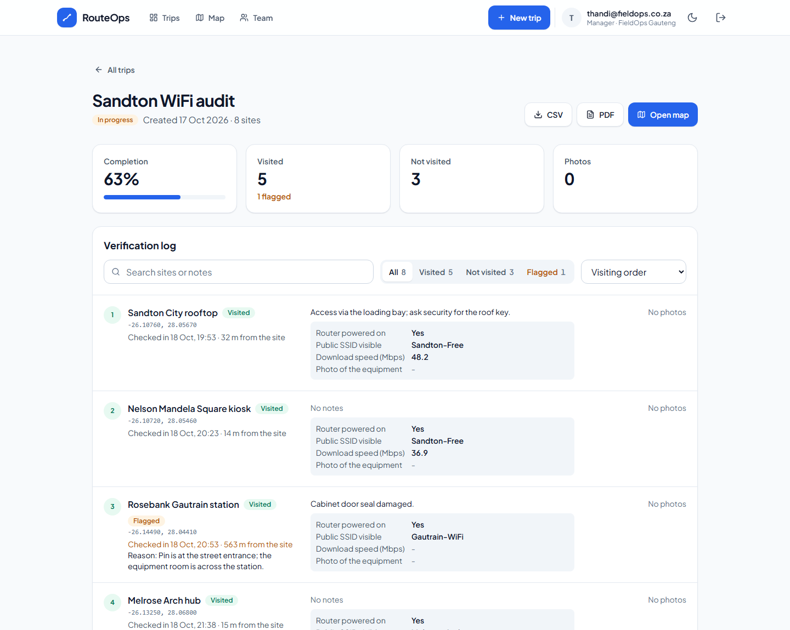
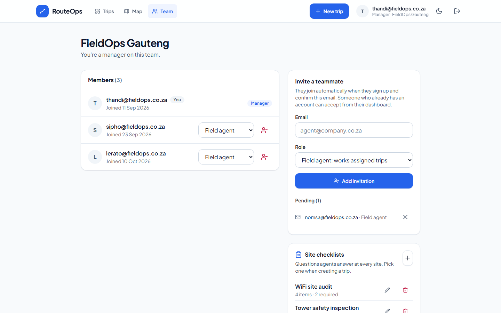
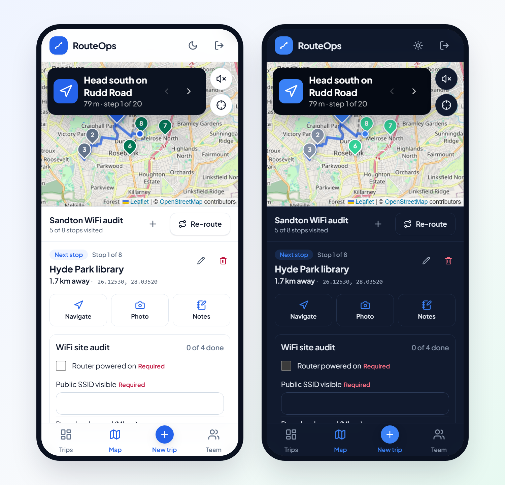
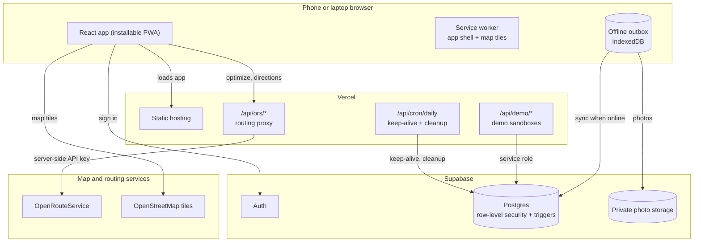
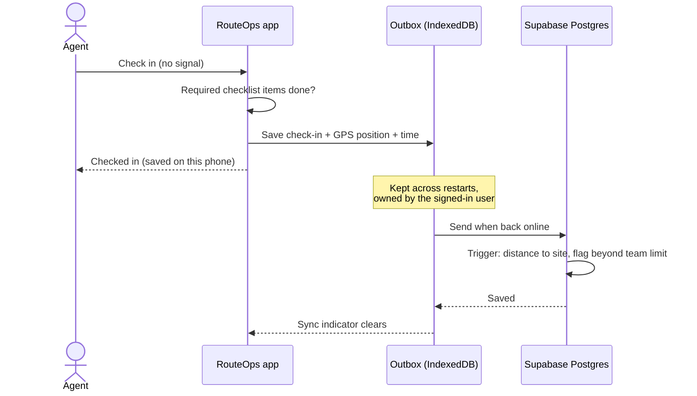

# RouteOps: Field Route Optimization & Site Verification

**Plan smarter routes. Verify every site.** RouteOps is a mobile-first web app for field teams: import a list of sites, get the fastest visiting order, drive it with turn-by-turn voice guidance, and prove every visit with GPS-verified check-ins, checklists and photos, even without signal.

[](https://github.com/TeekayVuyisile/Field-Route-Optimization-Site-Verification-System/actions/workflows/ci.yml)
[](LICENSE)
[](https://field-route-optimization-site-verif.vercel.app/)

### [Try the live demo](https://field-route-optimization-site-verif.vercel.app/)

Press **Try the live demo**: no sign-up. You get a private sandbox team with sample trips around Johannesburg and Pretoria, a **manager** and a **field agent** account you can switch between, flagged check-ins and a site checklist. Each sandbox is deleted after 24 hours, and nothing you do is visible to anyone else.



---

## Contents

- [Screenshots](#screenshots)
- [Features](#features)
- [How it works](#how-it-works)
- [Tech stack](#tech-stack)
- [Security model](#security-model)
- [Getting started](#getting-started)
- [Deployment](#deployment)
- [Project structure](#project-structure)
- [License](#license)

## Screenshots

| Landing page | Team trips (manager) |
| :---: | :---: |
|  |  |
| **New trip wizard: review sites on a map** | **Trip report: check-ins, flags and checklist answers** |
|  |  |
| **Team, checklists and check-in rules** | **On the phone, in light and dark** |
|  |  |

## Features

**Plan**
- **Import sites from CSV or Excel**: column names are guessed, South African decimal commas and degree-minute-second coordinates are read correctly, and swapped latitude/longitude is detected with a one-tap fix.
- **Review on a map before saving**: sites outside South Africa and unreadable rows are flagged.
- **Route optimization** via OpenRouteService (up to 70 stops), with a local nearest-neighbour fallback so a routing outage never leaves a driver without a plan.

**Drive**
- **Driver mode**: full-screen map, large turn-by-turn instructions, spoken guidance and arrival alerts.
- **Field-grade GPS**: jumpy fixes are filtered out; going off route recalculates from where you actually are.
- **Navigate in Google Maps** with one tap when you prefer it.

**Verify**
- **GPS-verified check-ins**: the database measures how far the phone was from the site and flags check-ins beyond the team's limit (default 150 m). The agent can add a reason.
- **Site checklists**: managers build them (tick box, short answer, number, photo); required items must be done before check-in.
- **Photo evidence**: compressed on the phone (a 12 MP photo becomes a few hundred KB), with thumbnails, stored privately per team.

**Works offline**
- **Installable app** (PWA) that opens without signal; map tiles you've viewed stay cached.
- **Offline outbox**: check-ins, notes, checklist answers and photos are saved on the phone first and sent when there's signal. Nothing is lost, and changes the server refuses are shown for retry.

**Report and manage**
- **Trip reports** with completion, flagged check-ins, notes, checklist answers and photos; export to **CSV** or a **PDF** built in the browser.
- **Teams**: managers plan, assign and follow trips; agents see the trips assigned to them.
- **Light and dark themes**, keyboard and screen-reader friendly.

## How it works

### Architecture



- The browser talks to **Supabase directly**; row-level security in Postgres decides what each user can read and write.
- The **routing proxy** keeps the OpenRouteService key on the server, checks the caller's session, rate-limits per user, and validates input.
- **Database triggers** do the work that must not be trusted to a phone: measuring check-in distance, enforcing required checklist items, and guarding who can assign trips.

### An offline check-in, end to end



## Tech stack

| Area | Technology |
| :--- | :--- |
| App | React 19, Vite, React Router, Zustand |
| UI | Tailwind CSS v4, Radix UI, Lucide icons, light and dark themes |
| Maps and routing | Leaflet + OpenStreetMap, OpenRouteService (optimization + directions) |
| Offline | vite-plugin-pwa (Workbox), IndexedDB outbox (idb-keyval) |
| Backend | Supabase: Auth, Postgres with row-level security, private Storage |
| Server functions | Vercel Functions (routing proxy, demo sandboxes, daily cron) |
| Files | PapaParse + SheetJS (import), @react-pdf/renderer (PDF reports) |
| Quality | Vitest + Testing Library (300+ tests), SQL tests against Postgres in Docker, ESLint, GitHub Actions CI |

## Security model

- **Row-level security on every table.** Managers see their whole team's trips; agents see trips they own or are assigned; nobody sees another team.
- **Rules enforced in the database, not the app:** check-in distance and flags, required checklist items, trip assignment, and who may change a trip's checklist.
- **Private photo storage**, read through short-lived signed URLs; each user can only write to their own folder.
- **API keys stay on the server:** the OpenRouteService key and the Supabase service-role key are never sent to browsers.
- **Demo sandboxes are isolated** like real teams, cannot invite real people, are capped and rate limited, and are removed with their files after 24 hours.
- Every migration ships with SQL tests that run in CI (`npm run test:db`).

## Getting started

**Requirements:** Node.js 22+, a [Supabase](https://supabase.com) project, an [OpenRouteService](https://openrouteservice.org) API key. Docker is only needed for the database tests.

```bash
git clone https://github.com/TeekayVuyisile/Field-Route-Optimization-Site-Verification-System.git
cd Field-Route-Optimization-Site-Verification-System
npm install
cp .env.example .env   # then fill it in
npm run dev
```

**Environment variables** (see [`.env.example`](.env.example)):

| Variable | Where it's used |
| :--- | :--- |
| `VITE_SUPABASE_URL`, `VITE_SUPABASE_ANON_KEY` | Browser: Supabase project URL and public anon key |
| `ORS_API_KEY` | Server only: OpenRouteService key for the routing proxy |
| `SUPABASE_SERVICE_ROLE_KEY` | Server only: demo sandboxes (optional) |
| `CRON_SECRET` | Server only: protects the daily cron endpoint (optional) |

**Database:** apply the files in [`supabase/migrations/`](supabase/migrations) in order in the Supabase SQL editor (they are idempotent), then create a private Storage bucket named `site-photos`. In Supabase Auth, keep **Confirm email** on: team membership trusts confirmed emails.

**Scripts**

```bash
npm run dev       # app + /api functions locally
npm test          # unit and component tests (Vitest)
npm run test:db   # migrations + SQL tests in a throwaway Postgres (Docker)
npm run lint
npm run build
```

## Deployment

Deployed on **Vercel**: connect the repository, add the environment variables above, and deploy. [`vercel.json`](vercel.json) routes `/api/*` to the server functions and schedules the daily cron, which keeps the free-tier Supabase project from pausing and removes expired demo sandboxes. A GitHub Actions workflow pings the database every other day as a backup (repository secrets `SUPABASE_URL`, `SUPABASE_ANON_KEY`).

## Project structure

```text
api/                  Vercel functions: ORS proxy, demo sandboxes, daily cron
  _lib/               shared server code and its tests (not deployed as endpoints)
src/
  pages/              Landing, Dashboard, CreateTrip, MapView, TripReview, Team, auth
  components/         UI kit (ui/), map driver mode (map/), layout, trips, team, demo
  features/           domain logic: navigation, offline outbox, sites, trips,
                      check-ins, checklists, reports, photos, import, team
  services/           OpenRouteService client (fallbacks, chunking, retries)
supabase/
  migrations/         numbered, idempotent SQL migrations
  tests/              SQL tests, including upgrade tests for existing data
design-system/        design tokens and UI rules
docs/screenshots/     images used in this README
```

## License

[MIT](LICENSE) © 2026 Teekay Manale

Map data © [OpenStreetMap](https://www.openstreetmap.org/copyright) contributors. Routing by [openrouteservice](https://openrouteservice.org).
